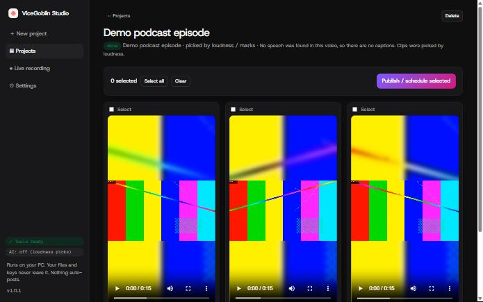
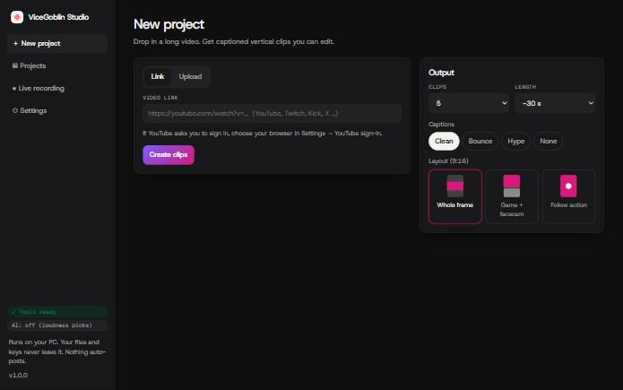
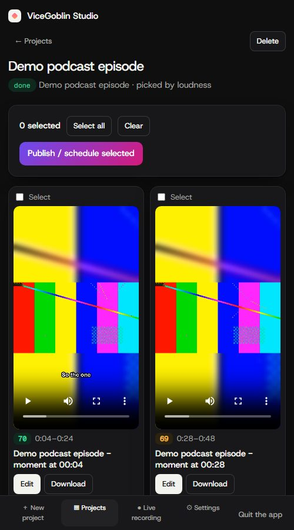

# ViceGoblin Studio

**Turn long videos, streams and podcasts into captioned vertical Shorts. Free, private, runs on your own Windows PC.**

### [Download for Windows](../../releases/latest/download/ViceGoblinStudio-Setup.exe)

No account. No subscription. No terminal. Everything is included in one installer.

## What it does

1. **Drop in a long video.** Upload a file or paste a link to a video you own.
2. **Get your best moments.** It transcribes the speech on your PC, scores the strongest moments and cuts vertical clips with a hook and a title.
3. **Edit anything.** Drag the trim handles, read the transcript, change caption style and layout, add your own voice-over, re-render one clip in seconds.
4. **Publish on your schedule.** Connect your own YouTube channel and queue a batch of Shorts hours apart. Nothing uploads until you confirm.

| | |
|---|---|
|  |  |

## Features

- **Word-by-word captions** in Clean, Bounce or Hype style, powered by Whisper speech recognition (a model is built in, so it works offline).
- **Dozens of languages**, including English, Hindi, Spanish, Portuguese and Arabic. Pick your language in Settings for the best accuracy.
- **Three vertical layouts:** whole frame on a blurred fill, gameplay plus facecam, or follow the action.
- **Timeline and transcript editing** with per-clip re-render.
- **Voice-over mixing** that lowers the original audio under your voice.
- **Batch scheduling to YouTube** with your own Google key.
- **Live recording** with a hotkey (F8) to mark great moments.
- **Optional AI clip picking** with a free Gemini key.
- **Private by design:** your videos, settings and keys never leave your computer.
- **Mobile-friendly interface** and an in-app notice when a new version is out.

## Install

1. Download `ViceGoblinStudio-Setup.exe` from the [latest release](../../releases/latest).
2. Run it. Windows may say **Unknown publisher** because the installer is new and not yet code-signed. Choose *More info*, then *Run anyway*.
3. Open **ViceGoblin Studio** from the Start menu. It checks that every tool is ready, then opens.

**Requirements:** Windows 10 or 11 (64-bit), about 8 GB RAM, 5 GB free disk space. Mac and Linux are not available yet.

Each release lists a SHA-256 checksum so you can verify your download.

## FAQ

**Is it really free?** Yes. It runs on your PC, so there are no servers to pay for.

**Are my videos uploaded anywhere?** No. Transcription, clipping and rendering all happen on your computer.

**What can I clip?** Your own videos, or ones whose owner has given you permission. Reusing someone else's video without permission can get your channel a copyright strike.

**Why does YouTube ask me to sign in?** For some links YouTube wants a login. In Settings, choose the browser you are signed in with. Or just upload the file.

## Versions

Releases follow [Semantic Versioning](https://semver.org/). See [Releases](../../releases) for notes on every version.

## Help and feedback

Questions and ideas: [Discussions](../../discussions). Bugs: [Issues](../../issues).

---

Licence: shown during install and kept in the install folder (`LICENSE.txt`). Open-source components are listed in `THIRD-PARTY-NOTICES.txt`.
This repository contains release downloads only. ViceGoblin Studio is an independent product and is not affiliated with YouTube or Google.
