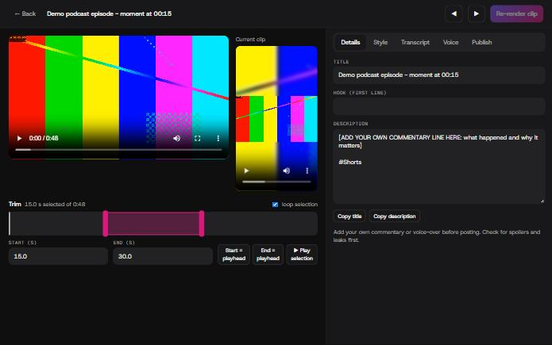
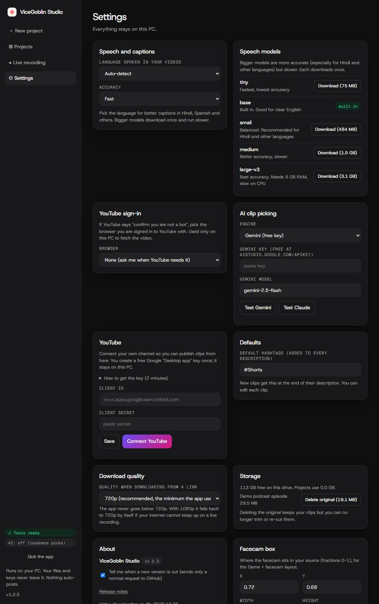

# ViceGoblin Studio

**Turn long videos, streams and podcasts into captioned vertical Shorts. Free, private, runs on your own Windows PC.**

### [Download for Windows](../../releases/latest/download/ViceGoblinStudio-Setup.exe)

No account. No subscription. No terminal. Everything is included in one installer.

## What it does

1. **Drop in a long video.** Upload a file or paste a link to a video you own.
2. **Get your best moments.** It transcribes the speech on your PC, scores the strongest moments and cuts vertical clips with a hook and a title.
3. **Edit anything.** Drag the trim handles, fix the captions, change caption style and layout, add your own voice-over, re-render one clip in seconds.
4. **Post it your way.** Download the clip, grab its subtitle file, or connect your own YouTube channel and queue a batch of Shorts hours apart. Nothing uploads until you confirm.

| | |
|---|---|
|  |  |
|  |  |

## Features

**Captions**
- **Word-by-word captions** in Clean, Bounce or Hype style, powered by Whisper speech recognition (a model is built in, so it works offline).
- **Dozens of languages**, including English, Hindi, Spanish, Portuguese and Arabic. Indian scripts are drawn with proper letter shaping. Pick your language in Settings for the best accuracy.
- **Fix captions:** correct a misheard word or a name, then re-render.
- **Subtitle files:** download a clip's captions as `.srt` or `.vtt`.

**Editing**
- **Three vertical layouts:** whole frame on a blurred fill, gameplay plus facecam, or follow the action.
- **Timeline and transcript editing** with per-clip re-render.
- **Voice-over mixing** that lowers the original audio under your voice.
- **Where this clip fits:** shows which platforms (Shorts, Reels, Facebook Reels, Moj/Josh/ShareChat) suit the clip's length. Platform limits change, so check each app before posting.

**Getting clips from anywhere**
- **Upload a file** or **paste a link** to a video you own.
- **Live recording** from Twitch or YouTube, with a hotkey (F8) to mark great moments. On a slow connection it adapts by itself and never goes below 720p.
- **Optional AI clip picking** with a free Gemini key (or your own Claude Code login).

**Publishing**
- **Batch scheduling to YouTube** with your own Google key. You confirm every upload.

**Looks after itself**
- **Diagnose and fix:** if something fails, one button explains in plain words what probably went wrong and applies the fix (set up YouTube support, update the downloader, pick a browser sign-in). It can also make a report you can copy and send, with links and your Windows user name hidden.
- **Storage:** see disk use per project and delete a project's big original video to free space.
- **Download quality** of 720p or 1080p.
- **In-app updates**, checked against a published checksum before anything installs.

**Private and safe by design**
- Your videos, settings and keys never leave your computer. Saved keys are encrypted with Windows' own protection.
- The app only answers to its own shortcut: other programs and other Windows users on the PC cannot control it.
- **Mobile-friendly interface.**

## Install

1. Download `ViceGoblinStudio-Setup.exe` from the [latest release](../../releases/latest).
2. Run it. Windows may say **Unknown publisher** because the installer is new and not yet code-signed. Choose *More info*, then *Run anyway*.
3. Open **ViceGoblin Studio** from the Start menu. It checks that every tool is ready, then opens.

**Requirements:** Windows 10 or 11 (64-bit), about 8 GB RAM, 5 GB free disk space. Mac and Linux are not available yet.

Each release lists a SHA-256 checksum so you can verify your download.

## FAQ

**Is it really free?** Yes. It runs on your PC, so there are no servers to pay for.

**Are my videos uploaded anywhere?** No. Transcription, clipping and rendering all happen on your computer. The only things that leave it are what you choose to send: a YouTube upload you confirm, or text for the optional AI picker.

**What can I clip?** Your own videos, or ones whose owner has given you permission. Reusing someone else's video without permission can get your channel a copyright strike.

**Why does YouTube ask me to sign in?** For some links YouTube wants a login. In Settings, choose the browser you are signed in with. Or just upload the file.

**Why did my live recording capture less than the whole stream?** Live video has to arrive as fast as it plays. If the connection between your PC and YouTube is slower than the stream, the app can only keep part of it. It keeps 720p quality rather than dropping lower, so the clips are made from what was captured. Signing in with a browser (Settings), waiting a while, or using a faster network usually helps. The Diagnose and fix button on a failed project explains what happened.

**The window says it lost connection.** The studio app was closed or updated. Open ViceGoblin Studio from the Start menu again; the page reconnects by itself.

## Support the project

ViceGoblin Studio is free and always will be. If it saves you time and you would like to help keep it improving, you can [sponsor the project on GitHub](https://github.com/sponsors/rudr19). Starring the repository and telling a creator friend helps just as much.

## Versions

Releases follow [Semantic Versioning](https://semver.org/). See [Releases](../../releases) for notes on every version, or the [changelog](CHANGELOG.md).

## Help and feedback

Questions and ideas: [Discussions](../../discussions). Bugs: [Issues](../../issues). When you report a bug, press **Diagnose and fix**, then **Copy report**, and paste it in.

---

Licence: shown during install and kept in the install folder (`LICENSE.txt`). Open-source components are listed in `THIRD-PARTY-NOTICES.txt`.
This repository contains release downloads only. ViceGoblin Studio is an independent product and is not affiliated with YouTube or Google.
